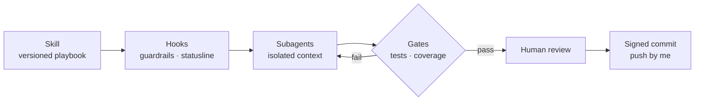

<picture>
  <source media="(prefers-color-scheme: dark)" srcset="./profile/header.svg">
  <source media="(prefers-color-scheme: light)" srcset="./profile/header-light.svg">
  
</picture>

<a href="./README.pt-BR.md">🇧🇷 Leia em português</a>

> I take backend systems from fragile to dependable: performance, test reliability, cloud migration, and the agent tooling that speeds it all up.

8 years in tech, 5 of them building Java backends. Remote from Brasília, Brazil.

## Now

<!-- NOW:START -->
- 🔨 **Building:** turnward, a new public repo, and open source PRs to Jackson and pandoc
- 📚 **Next up:** OCP Java 21 and Kafka (Confluent Fundamentals)
- ✍️ **Writing:** notes on running coding agents behind tests, gates and human review
<!-- NOW:END -->

Refreshed weekly by a Claude Code agent that opens a PR; I review and merge it.

## Selected work

| Problem | Approach | Result |
|---|---|---|
| An event-pipeline step took 10+ min and exhausted the DB connection pool | Serialized the consumer, swapped O(N) list lookups for sets, batched the inserts | **10+ min → ~6 s** |
| Large-range data export crashed with OOM | End-to-end streaming: O(1) reads, paged table, SXSSF Excel, low-level PDF (SXSSF alone was not enough) | **Constant memory**, OOM gone |
| Inherited E2E suite with dozens of failing regressions | Removed swallowed waits and catches pattern by pattern, one small PR each, plus strict SQL seeds and cleanups | **0 failed · 0 flaky** in every run |
| Legacy apps with little or no unit testing | Honest coverage (justified excludes only, dead code removed), then a coverage gate in the build | **100%** on all JaCoCo counters |
| Repetitive manual steps in a Java EE → cloud migration | Google ADK agents on shared building blocks, with guardrails in 3 layers (command allowlist, timeout, output truncation) | Manual setup turned into **reviewable agent runs** |

**Side projects:** [`agent-code-cli-java`](https://github.com/caiocv18/agent-code-cli-java) and [`agent-code-cli-rust`](https://github.com/caiocv18/agent-code-cli-rust), an agent runtime written from scratch (agent loop, tools, permission gating, context compaction) in Java 25 and Rust. The Rust build sits at 96.8% coverage and ships as a 5.5 MB binary.

## How I work with agents

Agents do the legwork; gates and a human decide what ships.

Claude Code · Codex CLI · Antigravity CLI · MCP · Ollama. Skills repo: *coming soon*.

## Stack

Also: WebFlux · Quarkus · JPA/Hibernate · Pub/Sub · ActiveMQ · MongoDB · Redis · Oracle · SQL Server · Keycloak · Resilience4j · Datadog · GitLab CI · JUnit · Testcontainers · JaCoCo · Playwright.

## Learning

- ☕ OCP Java SE 21 ([study log](https://github.com/caiocv18/road-to-java-ocp-17))
- 📨 Kafka (Confluent Fundamentals)
- 🏛️ Software architecture, DDD and event-driven design
- ✅ AWS Certified Cloud Practitioner · 🎓 BSc Computer Science (UCB) · Postgrad Full-Stack (PUCRS)

---

  <a href="mailto:caioviniciuscv18@gmail.com">Email</a> ·
  <a href="https://medium.com/@caiocv18">Medium</a>
   
  ⛪ Catholic · ⚜️ Scout · 🐱×4 🐶×3 · 🎸 John Mayer · 🚛 Euro Truck Simulator 2 · 🍵 tea-powered

