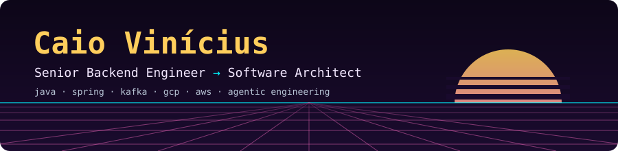
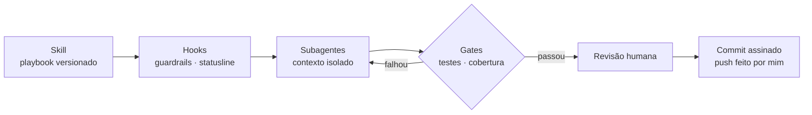

<picture>
  <source media="(prefers-color-scheme: dark)" srcset="./profile/header.svg">
  <source media="(prefers-color-scheme: light)" srcset="./profile/header-light.svg">
  
</picture>

<a href="./README.md">🇺🇸 Read in English</a>

> Levo sistemas backend de frágeis a confiáveis: performance, confiabilidade de testes, migração para a nuvem e as ferramentas de agentes que aceleram tudo isso.

8 anos em tecnologia, 5 deles construindo backends Java. Remoto, de Brasília.

## Agora

<!-- NOW:START -->
- 🔨 **Construindo:** um repositório público com as skills, os hooks e a statusline do Claude Code que uso todo dia
- 📚 **Próximos:** OCP Java 21 e Kafka (Confluent Fundamentals)
- ✍️ **Escrevendo:** notas sobre como rodar agentes de código atrás de testes, gates e revisão humana
<!-- NOW:END -->

Atualizado toda semana por um agente do Claude Code que abre um PR; eu reviso e faço o merge.

## Trabalhos em destaque

| Problema | Abordagem | Resultado |
|---|---|---|
| Uma etapa do pipeline de eventos levava mais de 10 min e esgotava o pool de conexões do banco | Consumidor serializado, buscas O(N) em lista trocadas por Set, inserts em batch | **10+ min → ~6 s** |
| Exportação de intervalos grandes caía por OOM | Streaming de ponta a ponta: leitura O(1), tabela paginada, Excel SXSSF, PDF low-level (só o SXSSF não bastou) | **Memória constante**, OOM eliminado |
| Suíte E2E herdada com dezenas de regressões falhando | Esperas e catches engolidos removidos padrão por padrão, um PR pequeno para cada, mais seeds e cleanups SQL estritos | **0 failed · 0 flaky** em todas as rodadas |
| Aplicações legadas com pouco ou nenhum teste unitário | Cobertura honesta (só excludes justificados, código morto removido), depois um gate de cobertura no build | **100%** em todos os contadores do JaCoCo |
| Passos manuais repetitivos numa migração de Java EE para a nuvem | Agentes Google ADK sobre blocos compartilhados, com guardrails em 3 camadas (allowlist de comandos, timeout, truncamento de saída) | Configuração manual virou **execução de agente revisável** |

**Projetos pessoais:** [`agent-code-cli-java`](https://github.com/caiocv18/agent-code-cli-java) e [`agent-code-cli-rust`](https://github.com/caiocv18/agent-code-cli-rust), um runtime de agente escrito do zero (agent loop, tools, permission gating, compactação de contexto) em Java 25 e Rust. A versão em Rust tem 96,8% de cobertura e sai num binário de 5,5 MB.

## Como trabalho com agentes

Os agentes fazem o trabalho braçal; os gates e uma pessoa decidem o que sobe.

Claude Code · Codex CLI · Antigravity CLI · MCP · Ollama. Repositório de skills: *em breve*.

## Stack

Também: WebFlux · Quarkus · JPA/Hibernate · Pub/Sub · ActiveMQ · MongoDB · Redis · Oracle · SQL Server · Keycloak · Resilience4j · Datadog · GitLab CI · JUnit · Testcontainers · JaCoCo · Playwright.

## Estudando

- ☕ OCP Java SE 21 ([diário de estudos](https://github.com/caiocv18/road-to-java-ocp-17))
- 📨 Kafka (Confluent Fundamentals)
- 🏛️ Arquitetura de software, DDD e design orientado a eventos
- ✅ AWS Certified Cloud Practitioner · 🎓 Bacharel em Ciência da Computação (UCB) · Pós em Full-Stack (PUCRS)

---

  <a href="mailto:caioviniciuscv18@gmail.com">E-mail</a> ·
  <a href="https://medium.com/@caiocv18">Medium</a>
   
  ⛪ Católico · ⚜️ Escoteiro · 🐱×4 🐶×3 · 🎸 John Mayer · 🚛 Euro Truck Simulator 2 · 🍵 movido a chá

